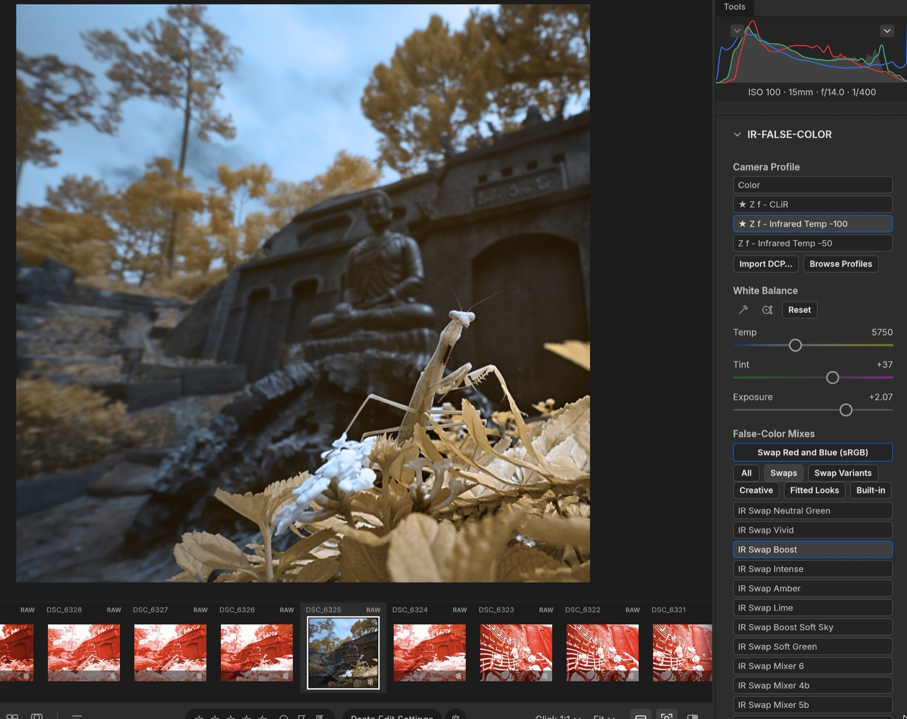

# LightCraft IR

An infrared photography fork of [storytold/lightcraft](https://github.com/storytold/lightcraft) — the open-source, pure-Rust photo library and non-destructive raw developer, rebased on upstream `v0.21.1`.

- **Website:** [https://irchrome.art](https://irchrome.art)
- **Telegram:** [https://t.me/revvoensovet](https://t.me/revvoensovet)
- **Upstream:** [https://github.com/storytold/lightcraft](https://github.com/storytold/lightcraft)



## Download (macOS)

Prebuilt macOS (Apple Silicon, `aarch64`) binaries are available on [GitHub Releases](https://github.com/irchrome/lightcraft/releases/latest):

1. Download `LightCraft-IR-*-macos-aarch64.dmg` from [GitHub Releases](https://github.com/irchrome/lightcraft/releases/latest).
2. Open the DMG and drag **`LightCraft IR.app`** into `/Applications`.
3. Because community fork builds are ad-hoc signed, on first launch run:
   ```sh
   xattr -dr com.apple.quarantine "/Applications/LightCraft IR.app"
   ```
   *(or allow it in **System Settings → Privacy & Security → Open Anyway**).*

> **Note:** Prebuilt releases are pure Rust (`MIT OR Apache-2.0`) and do **not** bundle LibRaw. If you need Nikon High Efficiency NEF (`HE` / `HE★`) decoding, build locally with `--features lightcraft/nikon-he` against a local LibRaw build (see [`IR-FORK.md`](IR-FORK.md)).

## What LightCraft IR adds

- **Three IR workspaces at the top of `Edit`:**
  - **`IR-FALSE-COLOR`** — camera-bound IR `.dcp` profiles, white-balance (`W`) and neutral mixer pickers, `Temp` down to `1300 K`, `Exposure`, prominent `Swap Red and Blue (sRGB)`, 46 filterable clean-room sRGB false-color mixes (`Swaps`, `Swap Variants`, `Creative`, `Fitted Looks`, `Built-in`), plus `Vibrance` and `Saturation`.
  - **`IR-MONO`** — neutral pickers, 7 infrared monochrome mixes (`Mono from Red (IR)`, `IR Mono Swap BW`, and classic B&W IR/colour filter mixes), plus `Exposure`, `Contrast`, `Whites`, `Blacks`, `Clarity`, and `Dehaze`.
  - **`AEROCHROME`** — camera-bound Chrome / Aerochrome `.dcp` profiles, white balance and `Exposure`, `Vibrance` / `Saturation`, `Foliage & Sky HSL`, and `Primary Calibration`.
- **Accurate IR white balance & clean whites:** `1300 K` lower Kelvin floor for deep-red IR raws, imported DCP `HueSatMap` and `LookTable` applied **after** white balance (Adobe DNG Spec, Chapter 6), RGB Channel Mixer + Neutral Picker, and automatic channel-swap reset when switching camera profiles (single-step `Undo`).
- **Soft gamut compression (`ir_gamut`):** ACES Reference Gamut Compression on CPU and GPU (active only with a user `.dcp` or non-neutral channel mixer) to prevent flat yellow/cyan fills in saturated IR skies while leaving normal photos untouched.
- **Camera-bound `.dcp` profiles & Lightroom recovery:** `.dcp` profiles match strictly by `UniqueCameraModel` and recover missing camera/lens metadata from imported `.lrcat` catalogs and RAW EXIF headers.
- **Extended RAW decoding:** compressed 12-bit Olympus `.ORF` support and optional local Nikon High Efficiency `.NEF` (`HE` / `HE★`) via `--features lightcraft/nikon-he`.
- **Standalone macOS app (`LightCraft IR.app`):** distinct infrared praying-mantis app icon and disabled upstream auto-update checks.

## Quick IR Workflow

1. **False-Color IR (`550–720 nm`):** Open **`Edit ▸ IR-FALSE-COLOR`**, pick an **IR `.dcp`** profile (or import one with **Import DCP…**), click **`W`** (or the neutral mixer target) on white foliage/clouds/neutral stone, adjust **`Exposure`**, then apply **`Swap Red and Blue (sRGB)`** or choose a recipe from `Swaps` / `Swap Variants`.
2. **Monochrome IR (`720 / 850 nm`):** Open **`Edit ▸ IR-MONO`**, balance foliage/neutral grey with **`W`**, pick **`Mono from Red (IR)`** or `IR Mono Swap BW`, and shape tonal contrast.
3. **Aerochrome / IRChrome:** Open **`Edit ▸ AEROCHROME`**, select a **Chrome / Aerochrome `.dcp`**, set white balance and `Exposure`, and fine-tune **`Foliage & Sky HSL`** and **`Primary Calibration`**.

## Building from source (macOS)

See [`AGENTS.md`](AGENTS.md), [`IR-FORK.md`](IR-FORK.md), and [`docs/IR-FORK-INVENTORY.md`](docs/IR-FORK-INVENTORY.md).

```sh
./tools/install-macos-app.sh --install
```

Add `--nikon-he` if you have a local LibRaw build in `~/Documents/_vendor/LibRaw` (or `LIBRAW_DIR`), or `--dmg dist/release/LightCraft-IR.dmg` to build a DMG.

## Compatibility & Licence

Develop settings written by LightCraft IR store extra IR fields (`ir_mix`) that upstream LightCraft ignores and drops when saving — avoid editing the same library simultaneously with both builds.

Licensed under `MIT OR Apache-2.0` ([`LICENSE-MIT`](LICENSE-MIT), [`LICENSE-APACHE`](LICENSE-APACHE), [`NOTICE`](NOTICE)), as upstream. The ArtCraft name, wordmark, and logos are trademarks of the ArtCraft Team (`docs/brand/` is excluded per upstream's licence). Maintained independently at [irchrome.art](https://irchrome.art) and [t.me/revvoensovet](https://t.me/revvoensovet); not affiliated with or endorsed by ArtCraft. No Adobe camera profiles, lens profiles, or third-party LUTs are included in this repository ([`assets/ATTRIBUTION.md`](assets/ATTRIBUTION.md)).
